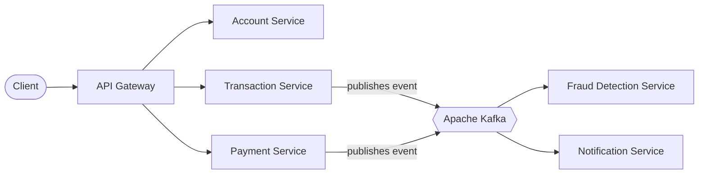

# BankAOS: Bank System

BankAOS is a backend banking system built as a set of Spring Boot microservices. Services communicate through an API gateway and Apache Kafka events: a transaction is processed, checked for fraud, and a notification is sent to the customer. I've learned SAGA design pattern


## Table of Contents

- [Features](#features)
- [Architecture](#architecture)
- [Services](#services)
- [Tech Stack](#tech-stack)
- [Getting Started](#getting-started)
- [Configuration](#configuration)
- [API Overview](#api-overview)
- [Testing](#testing)
- [Project Structure](#project-structure)
- [Roadmap](#roadmap)
- [Contributing](#contributing)
- [License](#license)
- [Author](#author)

## Features

- Single entry point through an **API gateway** (routing, [authentication / rate limiting, if implemented]).
- **Account management:** [create accounts, view balance, ...].
- **Transaction processing:** [deposit, withdrawal, transfer, ...].
- **Payments:** [what the payment service handles].
- **Fraud detection:** transactions are analysed asynchronously via Kafka events: [rules or checks you implemented].
- **Notifications:** customers are notified after [transaction / fraud alert] events: [email, log, ...].
- Each service runs independently and has its own [database / configuration].

## Architecture



**How a transaction flows**

1. The client sends a request to the API gateway, which routes it to the right service.
2. The transaction service [validates the request, updates the account, saves the transaction].
3. It publishes a `[TransactionCreated]` event to Kafka.
4. The fraud detection service consumes the event and [flags suspicious transactions].
5. The notification service consumes [the event] and notifies the customer.

**Design decisions**

- **Kafka for events:** one event can be consumed by several services without the producer knowing them (loose coupling).
- **[Redis for ...]:** [caching / idempotency / rate limiting: describe your real use].
- **[Other decision]:** [why].

## Services

| Service | Responsibility | Port |
|---|---|---|
| `api-gateway` | Single entry point, request routing | [80] |
| `account-service` | [Customer accounts and balances] | [2000] |
| `transaction-service` | [Transaction processing and history] | [2001] |
| `payment-service` | [Payment handling] | [2003] |
| `fraud-detection-service` | [Consumes events, detects suspicious activity] | [2002] |
| `notification-service` | [Consumes events, sends notifications] | [2004] |

## Tech Stack

| Category | Technology |
|---|---|
| Language | Java [version] |
| Framework | Spring Boot [version], Spring Web, Spring Data JPA |
| Messaging | Apache Kafka |
| Cache | Redis |
| Database | [PostgreSQL / H2] |
| Gateway | [Spring Cloud Gateway] |
| Build | Maven |
| Containers | Docker, Docker Compose |
| Testing | JUnit, Mockito, [Postman] |

## Getting Started

### Prerequisites

- Java [version] (JDK)
- Maven [version] or the included wrapper
- Docker and Docker Compose

### Run the project

```bash
# 1. Clone the repository
git clone https://github.com/elhamdiaziz55-collab/bankaos.git
cd bankaos

# 2. Start the infrastructure (Kafka, Redis, database)
docker compose up -d

# 3. Start each service (in separate terminals)
cd account-service && ./mvnw spring-boot:run
# repeat for: transaction-service, payment-service,
# fraud-detection-service, notification-service, api-gateway
```

> [Replace with your real commands. Adding a `docker-compose.yml` at the repository root makes this section work with one command.]

The system is then available at `http://localhost:[gateway-port]`.

## Configuration

Settings live in each service's `application.yml` (or `.properties`). Never commit real secrets; use environment variables.

| Variable | Description | Example |
|---|---|---|
| `SPRING_KAFKA_BOOTSTRAP_SERVERS` | Kafka address | `localhost:9092` |
| `SPRING_DATA_REDIS_HOST` | Redis host | `localhost` |
| `[DB_URL]` | Database URL | `[jdbc:postgresql://localhost:5432/bank]` |

## API Overview

All requests go through the gateway.

| Method | Endpoint | Description |
|---|---|---|
| `POST` | `/[api/accounts]` | [Create an account] |
| `GET` | `/[api/accounts/{id}]` | [Get account details] |
| `POST` | `/[api/transactions]` | [Create a transaction] |
| `GET` | `/[api/transactions/{id}]` | [Get a transaction] |

[Add a Postman collection or Swagger/OpenAPI link if you have one.]

## Testing

```bash
# Run tests for one service
cd transaction-service && ./mvnw test
```

- [Unit tests with JUnit and Mockito]
- [Integration tests, Arrange-Act-Assert pattern]
- [Manual API testing with Postman]

## Project Structure

```text
bankaos/
├── api-gateway/
├── account-service/
├── transaction-service/
├── payment-service/
├── fraud-detection-service/
├── notification-service/
├── docker-compose.yml        # [add]
└── README.md
```

## Roadmap

- [ ] [Add JWT authentication with Spring Security]
- [ ] [Add a CI pipeline with GitHub Actions]
- [ ] [Add distributed tracing / centralized logging]
- [ ] [Deploy with Kubernetes]

## Contributing

Suggestions and pull requests are welcome. Open an issue first to discuss major changes.

1. Fork the repository
2. Create a branch: `git checkout -b feature/my-feature`
3. Commit your changes: `git commit -m "feat: add my feature"`
4. Push the branch and open a pull request

## License

Distributed under the MIT License. See `LICENSE` for details. [Add a LICENSE file to the repository.]

## Author

**Mohamed Aziz Elhamdi**: Software Engineering Student at ISSAT Sousse

[GitHub](https://github.com/elhamdiaziz55-collab) · [LinkedIn](https://linkedin.com/in/your-profile)
