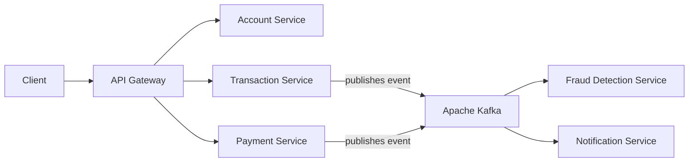

# BankAOS: Bank System

BankAOS is a backend banking system built as a set of Spring Boot microservices. Services communicate through an API gateway and Apache Kafka events: a transaction is processed, checked for fraud, and a notification is sent to the customer. I'd learned SAGA design pattern in this project.

## Table of Contents

- [Features](#features)
- [Architecture](#architecture)
- [Services](#services)
- [Tech Stack](#tech-stack)
- [API Overview](#api-overview)
- [Testing](#testing)

## Features

- Single entry point through an **API gateway** (routing, [authentication / rate limiting, if implemented]).
- **Account management:** [create accounts, view balance, ...].
- **Transaction processing:** [deposit, withdrawal, transfer, ...].
- **Payments:** [what the payment service handles].
- **Fraud detection:** transactions are analysed asynchronously via Kafka events: [rules or checks you implemented].
- **Notifications:** customers are notified after [transaction / fraud alert] events: [email, log, ...].
- Each service runs independently and has its own [database / configuration].

## Architecture

**How a transaction flows**

1. The client sends a request to the API gateway, which routes it to the right service.
2. The transaction service [validates the request, updates the account, saves the transaction].
3. It publishes a `[TransactionCreated]` event to Kafka.
4. The fraud detection service consumes the event and [flags suspicious transactions].
5. The notification service consumes [the event] and notifies the customer.

## Services

| Service | Responsibility | Port |
|---|---|---|
| `api-gateway` | Single entry point, request routing | [80] |
| `account-service` | [Customer accounts and balances] | [2000] |
| `transaction-service` | [Transaction processing and history] | [2001] |
| `payment-service` | [Payment handling] | [2003] |
| `fraud-detection-service` | [Consumes events, detects suspicious activity] | [2002] |
| `notification-service` | [Consumes events, sends notifications] | [2004] |

## Tech Stack

| Category | Technology |
|---|---|
| Language | Java [version] |
| Framework | Spring Boot [version], Spring Web, Spring Data JPA |
| Messaging | Apache Kafka |
| Cache | Redis |
| Database | [PostgreSQL / H2] |
| Gateway | [Spring Cloud Gateway] |
| Build | Maven |
| Containers | Docker, Docker Compose |
| Testing | JUnit, Mockito, [Postman] |
| Testing | JUnit, Mockito, [Postman] |

## API Overview

All requests go through the gateway.

| Method | Endpoint | Description |
|---|---|---|
| `POST` | `/[api/accounts]` | [Create an account] |
| `GET` | `/[api/accounts/{id}]` | [Get account details] |
| `POST` | `/[api/transactions]` | [Create a transaction] |
| `GET` | `/[api/transactions/{id}]` | [Get a transaction] |

## Testing

- [Manual API testing with Postman]

